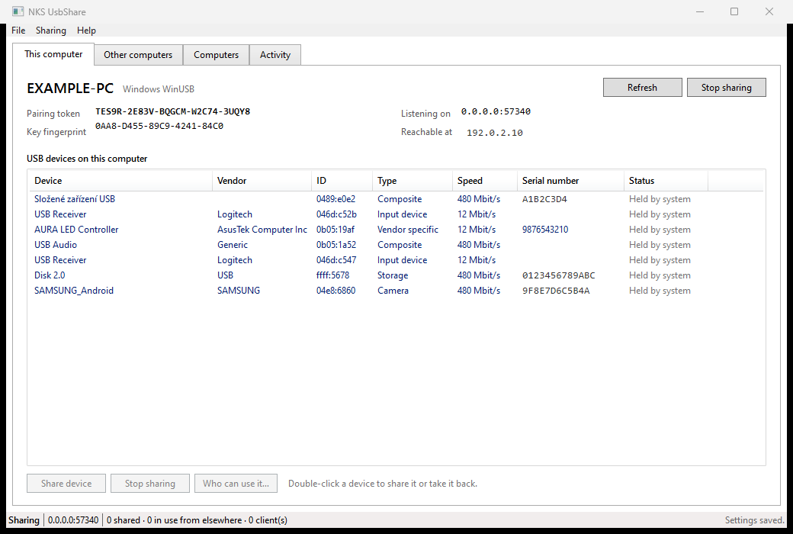
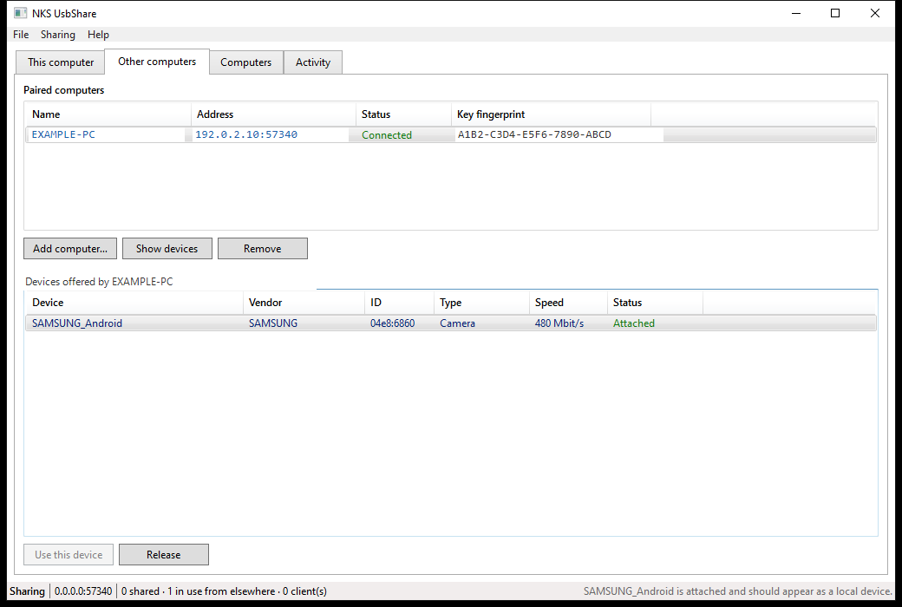
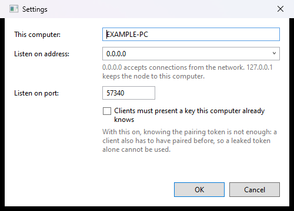
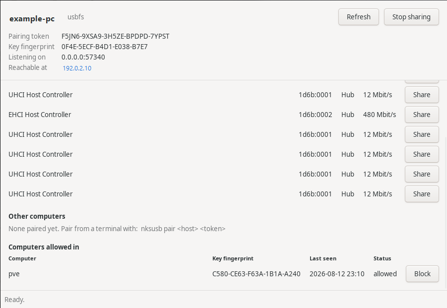

[](https://github.com/nks-hub/nks-usbshare/actions/workflows/ci.yml)
[](https://github.com/nks-hub/nks-usbshare/actions/workflows/release.yml)
[](https://dotnet.microsoft.com/)
[](#dependencies)

# NKS UsbShare v1.0.0

Share USB devices between computers over an encrypted TCP link — on a LAN, across a VPN, or over
the internet. A flash drive, a phone, a dongle: plug it into one machine, use it from another as
though it were plugged in there.

Written in C# on .NET 9. **The solution has no NuGet packages at all** — the wire protocol, the
descriptor parser, the SCSI and FAT32 readers, the MCP server, the AppKit and GTK bindings and the
test runner are written here, on top of what the operating system already provides: WinUSB and
SetupAPI on Windows, usbfs on Linux, IOKit on macOS, and the .NET TLS stack.

One thing cannot be written in user mode at all — the virtual USB controller that makes a remote
device visible to *every* application on Windows. That is a kernel driver, and it has to be signed
by someone Windows already trusts. The application **fetches and installs it on its own** the
first time it is needed; see [Dependencies](#dependencies).

## Screenshots

**The computer a device is plugged into** — everything attached, and what is shared:



**The computer using it** — a phone attached across the network, listed as a local device:



| Settings | Linux |
|---|---|
|  |  |

Every window shows the same thing in the same shape: identity and pairing details pinned at the
top, then a table of devices with a button per row, then the computers allowed in.

## What works today

| | Windows | Linux | macOS |
|---|---|---|---|
| Enumerate local USB devices | verified | verified | verified |
| Share a device (export) | verified | verified | implemented |
| Claim a device from its class driver | verified | n/a | n/a |
| Use a remote device from an application | verified | verified | verified |
| Present a remote device to the whole OS | verified | verified | not possible today |
| Native application window | WPF, verified | GTK, verified | AppKit, verified |
| Command line | verified | verified | verified |
| Per-device access lists and blocking | verified | verified | implemented |

"Verified" means it was exercised against real hardware; "implemented" means the code is complete
but has not yet been run on that platform.

The Windows export path was checked end to end: a USB flash drive plugged into one machine was
claimed from its class driver, shared, and then read from a Windows 11 virtual machine on another
host across a VPN. The virtual machine pulled the device and configuration descriptors straight off
the hardware — mass storage, class 08/06/50, two 512 byte bulk endpoints — proving real transfers
cross the encrypted link rather than cached metadata.

```
nksusb probe 192.0.2.10 'USB\VID_FFFF&PID_5678\0123456789ABC'

  Disk 2.0  (ffff:5678)
  device descriptor (18 bytes)
    1201000200000040FFFF7856000201020301
    usb 2.00   vendor ffff   product 5678   class 00   max packet 64
  configuration descriptor, 32 bytes total
    interface 0 alt 0  class 08/06/50
      endpoint 0x01  Bulk        512 bytes
      endpoint 0x82  Bulk        512 bytes
```

The import path was then checked the same way. With a virtual controller installed, `nksusb attach`
handed the same flash drive to the virtual machine's own USB stack: Windows enumerated it, bound
its ordinary mass storage driver, and mounted the filesystem as a removable drive. Files written
from the virtual machine landed on the physical device, and a two megabyte round trip came back
byte for byte identical.

## Architecture

```
   machine A (host)                              machine B (client)
   +-----------------------+                     +-----------------------+
   | USB device            |                     | application           |
   |   |  WinUSB / usbfs   |                     |   ^  RemoteUsbDevice  |
   |   v                   |   TLS 1.3, port     |   |                   |
   | NodeService           |                     | NodeService           |
   |   HostServer  --------+------  57340  ------+-> UsbShareClient      |
   +-----------------------+                     +-----------------------+
```

Transfers cross the link as URBs: the client submits a request describing an endpoint, a transfer
type and a payload; the host issues it through the operating system and sends back the result.
Control, bulk and interrupt transfers are carried; isochronous is carried by the protocol and
implemented on the Linux backend.

### Components

| Component | Runtime | Description |
|-----------|---------|-------------|
| **NksUsbShare.Core** | .NET 9 | Wire protocol, TLS, USB backends, host and client engines |
| **NksUsbShare.Cli** | .NET 9 | `nksusb` — the whole feature set from a terminal, all platforms |
| **NksUsbShare.Desktop** | .NET 9 (WPF) | Windows application |
| **NksUsbShare.Gtk** | .NET 9 (GTK 3) | Linux application, plain P/Invoke |
| **NksUsbShare.Mac** | .NET 9 (AppKit) | macOS application, on the Objective-C runtime |
| **NksUsbShare.Mcp** | .NET 9 | Management server speaking the Model Context Protocol |

### Security

| Layer | Technology | Scope |
|-------|-----------|-------|
| Transport | TLS 1.3 (TLS 1.2 floor) | Every connection, before a single protocol byte |
| Host identity | Self-signed P-384, pinned on first use | Client refuses a host whose key changed |
| Client identity | Self-signed P-384, always presented | Host names, blocks and restricts by key |
| Admission | 125-bit pairing token, constant-time compare | Every connection |
| Per device | Allow list of client fingerprints | Listing and opening |

- **Public-key pinning.** Each node generates its certificate on first run. A client pins the
  host's fingerprint the first time it connects and refuses to continue if it ever changes. There
  is no certificate authority, because there is no third party in the link.
- **Pairing tokens.** 125 bits of entropy, shown in groups of five characters with the ambiguous
  ones removed so they can be read aloud.
- **Every client is named.** A client always presents its own key, so the host records which
  computers have used it and can tell them apart. Nothing has to be turned on for this.
- **Blocking.** A computer can be refused outright. It is disconnected at once and anything it was
  holding is released, so blocking does not wait for it to come back.
- **Optional mutual TLS**, where a client must present a key the host already knows before the
  handshake completes at all.

## Quick start

### Desktop application

**Windows** — `dotnet build src/NksUsbShare.Desktop`, then run `NksUsbShare.exe`.

**macOS** — `dotnet publish src/NksUsbShare.Mac -r osx-arm64 --self-contained`. Put the binary in
a `.app` bundle so LaunchServices treats it as a normal application.

**Linux** — `dotnet publish src/NksUsbShare.Gtk -r linux-x64 --self-contained`, then run
`nksusb-gtk`. On a machine with no display it says so and exits rather than failing obscurely.

All of them accept `--home <dir>` like the terminal application, so a second node can be run beside
the real one without disturbing its settings.

### Command line (all platforms)

```bash
dotnet build src/NksUsbShare.Cli

nksusb list                          # local devices and what is shared
nksusb share 3                       # share the third device, claiming it from Windows if needed
nksusb giveback                      # return every claimed device to its original driver
nksusb serve                         # run the node until interrupted

nksusb pair 192.0.2.10 ABCDE-FGHIJ-KLMNO-PQRST-UVWXY
nksusb remote 192.0.2.10             # what that host offers
nksusb import 192.0.2.10 <device-id> # hold a device until interrupted
nksusb attach 192.0.2.10 <device-id> # hand it to this machine's USB stack
nksusb storage 192.0.2.10 <device-id># read a remote disk directly, without a driver

nksusb clients                       # computers that have connected here
nksusb access 3 anyone               # offer the third device to any paired computer
nksusb access 3 laptop workshop      # or only to those two
nksusb block laptop                  # refuse a computer even with the right token
```

A computer can be named by its name or by any unambiguous part of its key fingerprint. These
commands write the settings file, so a node that is already running picks them up when it restarts;
the windowed applications change their own running node straight away.

Settings live in `%APPDATA%\nks-usbshare` or `~/.config/nks-usbshare`, overridable with
`NKS_USBSHARE_HOME` or `--home`.

### MCP server

```json
{
  "mcpServers": {
    "nks-usbshare": {
      "type": "stdio",
      "command": "<path-to>/nksusb-mcp"
    }
  }
}
```

| Tool | Description |
|------|-------------|
| `node_info` | Identity, platform, pairing token and listening address |
| `list_local_devices` | Local USB devices and whether each one is shared |
| `share_device` / `unshare_device` | Offer a device, optionally claiming it first |
| `release_claimed_devices` | Give every claimed device back to its original driver |
| `list_clients` | Computers that have connected to this node |
| `set_client_blocked` | Refuse or re-admit a computer |
| `set_device_access` | Choose which computers may use a shared device |
| `list_hosts` / `pair_host` / `forget_host` | Manage paired computers |
| `list_remote_devices` | What another computer offers |
| `import_device` / `release_device` / `list_imports` | Hold and release remote devices |
| `recent_activity` | The node's activity log |

## The driver question

Two rows in the table above are blocked on the same fact: **only kernel-mode code can take a USB
device away from its class driver, or present a virtual one.** This is not an implementation gap
that more user-mode code can close.

**Sharing on Windows** requires the device to be bound to the in-box `winusb.sys` instead of its
class driver. **The applications do this themselves** — sharing a device Windows is holding asks
for administrator approval once and then hands it over. Nothing has to be installed for that: a
self-signed code-signing certificate, a generated INF and a signed catalog are all produced with
tooling that ships with Windows, and **Secure Boot stays on**, because `winusb.sys` is already
signed by Microsoft and only the small package pointing at it has to be trusted.

```bash
nksusb share 7          # claims the device from Windows first if it has to
nksusb giveback         # returns every claimed device to its original driver
```

In the desktop application the button reads *Claim and share*, and *Sharing → Give devices back*
undoes it. The same helper is available on its own as `tools/bind-winusb.ps1` for scripted setups.

Two details are worth knowing, because both took real hardware to find:

- A **manufacturer's driver that is WHQL signed outranks this package** no matter what the INF
  says, because Windows weighs the signature before it weighs how well the hardware id matched. A
  phone therefore stays on its vendor driver until the choice is forced, which is a documented
  call rather than a trick.
- Windows often records the new driver and **leaves the old device stack standing** until the
  device disappears and comes back. On a composite device such as a phone the old interface nodes
  keep holding the interfaces and nothing can open it. Restarting the node, restarting the hub and
  disabling the device are all refused while the machine has a pending reboot, so the claim ends by
  **cycling the device's hub port** — a replug performed in software, which goes through anyway.

While a device is shared it stops working as its normal self: a flash drive disappears from
Explorer, a keyboard stops typing. That is what sharing a USB device means on every product that
does this, and giving it back restores the original driver.

**Using a remote device as though it were plugged in locally** needs a virtual USB host controller.
Only kernel-mode code can create one, so this is the single piece the project does not provide
itself. What it provides instead is everything around it: `nksusb attach` imports the device,
publishes it on a plain USB/IP endpoint bound to **loopback only**, and lets the machine's own
controller attach to that. The network hop is still carried by the encrypted link — the plaintext
protocol never leaves the machine.

Which controller answers depends on the platform:

- **Linux** already has one in the kernel, `vhci_hcd`. Nothing has to be written, installed or
  signed.
- **Windows** has no in-box virtual device. It ships the framework to build one —
  [`UdeCx`](https://learn.microsoft.com/en-us/windows-hardware/drivers/usbcon/writing-a-ude-client-driver),
  the USB Device Emulation class extension — but a KMDF client driver still has to be written and
  signed. Rather than duplicate that, the controller from
  [usbip-win2](https://github.com/vadimgrn/usbip-win2) is used, and **the application installs it
  itself** the first time a device is attached. Nothing has to be downloaded or set up beforehand.
- **macOS** cannot do this at all today. DriverKit deliberately drives real hardware only —
  `USBDriverKit` matches on the vendor and product id of a device that is physically present, and
  Apple applies the same policy elsewhere, explicitly refusing `AudioDriverKit` for virtual audio
  devices. The one class Apple does permit to be invented is HID, through `HIDDriverKit`'s virtual
  device entitlement. Everything else means a kernel extension, which on Apple Silicon requires the
  user to drop Startup Security to "Reduced Security" from Recovery. Every commercial product in
  this space still ships a kext on macOS for the same reason.

On macOS, where no virtual device can be created at all, a remote device is still reachable
through `RemoteUsbDevice` — real control, bulk and interrupt transfers from your own code — the
operating system's driver stack simply does not see it. For storage that is enough to be useful:
`nksusb storage` speaks SCSI over Bulk-Only Transport and reads the medium directly.

```
nksusb storage 192.0.2.10 'USB\VID_FFFF&PID_5678\0123456789ABC'

  SCSI inquiry     Generic Flash Disk rev 2.00
  capacity         31,334,400 blocks of 512 bytes (14.94 GB)
  partition        type 0x0c, 31,332,288 blocks from 2,048
  volume label     EXAMPLE

  root directory   3 entries
    <dir> System Volume Information            2026-05-13 19:42
          example-note.txt                             80  2026-08-12 23:01
          example-2mb.bin                       2,097,152  2026-08-12 23:01
```

That listing was produced on a Mac, from a flash drive plugged into a Windows machine.

A driver is only unavoidable for *arbitrary* devices. Storage, printers and scanners each have a
network protocol both operating systems already speak — iSCSI, IPP, and eSCL — so those three
classes could be carried with no kernel component anywhere.

## Dependencies

**In the build: none.** There is no NuGet package anywhere in the solution, and none in the test
project either. The wire protocol, the JSON-RPC of the MCP server, the descriptor parser, the SCSI
layer, the FAT32 reader, the AppKit and GTK bindings and the test runner are all written here.

**At runtime on Windows: one driver, installed for you.** Handing a remote device to the whole
operating system needs a virtual USB controller, and only kernel-mode code can provide one. The
controller comes from [usbip-win2](https://github.com/vadimgrn/usbip-win2) (BSD-2-Clause), whose
drivers carry a *Microsoft Windows Hardware Compatibility Publisher* signature and therefore
install on stock Windows with Secure Boot left on.

Nobody has to go and find it. The first time a device is attached, the application:

1. asks the controller's own tool whether it is there and working — the file being on disk is not
   the same thing, because an uninstall can take the driver and leave the files;
2. downloads the pinned release (**0.9.7.8**) if it is not;
3. **checks it against a pinned SHA-256** and refuses to run a file that does not match;
4. installs it silently, and
5. restarts any USB controllers Windows parked while installing, so nothing on the machine — a
   keyboard, a mouse — is left dead waiting for a reboot.

Windows asks for administrator consent once, for the driver installation. That prompt is the only
part that cannot be taken off the user, and there is no way around it for any product that
installs a driver.

Linux needs none of this: `vhci_hcd` is already in the kernel and is driven straight through
sysfs. macOS cannot host a virtual USB device at all, with or without a third-party driver.

## Build

```bash
dotnet build NksUsbShare.sln
dotnet run --project tests/NksUsbShare.Tests

# self-contained binaries
dotnet publish src/NksUsbShare.Cli -c Release -r win-x64  --self-contained -p:PublishSingleFile=true
dotnet publish src/NksUsbShare.Cli -c Release -r linux-x64 --self-contained -p:PublishSingleFile=true
dotnet publish src/NksUsbShare.Cli -c Release -r osx-arm64 --self-contained -p:PublishSingleFile=true
```

No test framework is used, for the same reason nothing else is: tests are plain methods, failures
are exceptions, and the exit code is what matters. The suite covers the wire protocol, descriptor
parsing, the TLS and pairing layer, per-device access lists, blocking, and a full host-to-client
round trip over a real socket. Tests that need hardware skip themselves when there is none.

## Project structure

```
NksUsbShare.sln
├── src/NksUsbShare.Core/
│   ├── Protocol/              the wire format: framing, messages, errors
│   ├── Security/              TLS, node identity, pairing tokens
│   ├── Host/                  the side a device is plugged into
│   ├── Client/                the side using it, incl. the controller setup
│   ├── Usb/Windows|Linux|Mac/ one backend per platform
│   └── Storage/               SCSI and FAT32, for reading a disk without a driver
├── src/NksUsbShare.Cli/       cross-platform command line
├── src/NksUsbShare.Desktop/   WPF application for Windows
├── src/NksUsbShare.Gtk/       GTK application for Linux
├── src/NksUsbShare.Mac/       AppKit application for macOS
├── src/NksUsbShare.Mcp/       Model Context Protocol server
├── tests/NksUsbShare.Tests/   test suite
├── tools/bind-winusb.ps1      hands a Windows device to WinUSB and back again
└── .github/workflows/         CI + Release
```

The Windows claim currently runs through `tools/bind-winusb.ps1`, driven from an elevated child
process. A native replacement is in `Usb/Windows/` — the device tree, the forced driver install
and the hub port cycle are already native and in use; building the driver catalog without the
script is not finished, and the file says so plainly rather than pretending otherwise.

## Contributing

1. Fork the repository
2. Create your feature branch (`git checkout -b feature/amazing-feature`)
3. Commit your changes (`git commit -m 'feat: description'`)
4. Push to the branch (`git push origin feature/amazing-feature`)
5. Open a Pull Request

## Support

- Email: dev@nks-hub.cz
- Bug reports: [GitHub Issues](https://github.com/nks-hub/nks-usbshare/issues)

## License

Private — NKS Development

---

<p align="center">
  Made by <a href="https://github.com/nks-hub">NKS Hub</a>
</p>
